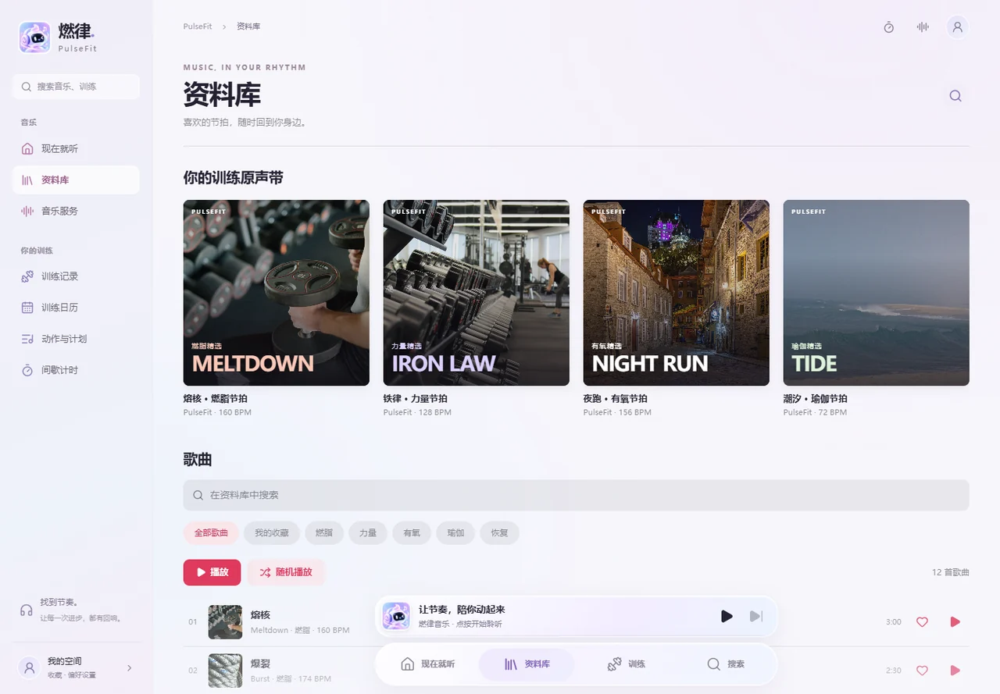
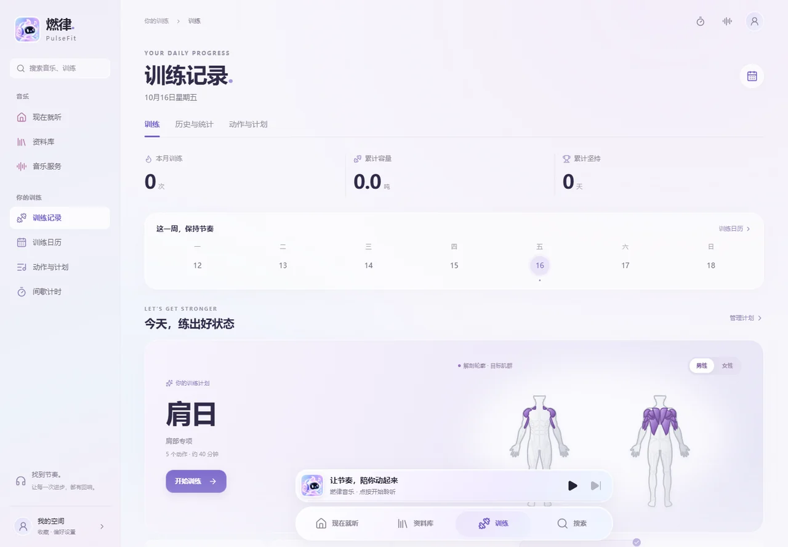
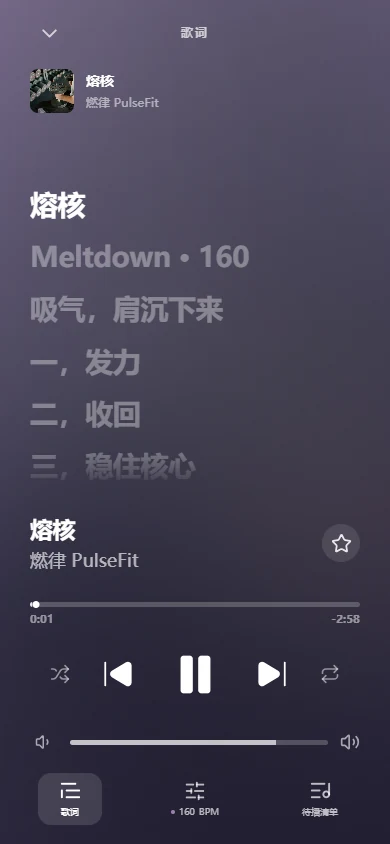

# 燃律 PulseFit

<p align="center">
  
</p>

<p align="center">
  把音乐节拍、训练计划与组数记录放进同一个应用。
</p>

<p align="center">
  <a href="https://github.com/yokelyaooooo/pulsefit/actions/workflows/release.yml"></a>
  <a href="LICENSE"></a>
</p>

燃律是一款为日常力量训练与有氧训练设计的音乐健身应用。它提供随训练节奏变化的本地音乐、可同步的个人音乐资料库、完整的训练记录，以及按动作高亮目标肌群的训练总结。桌面端使用侧边导航，移动端使用固定 Dock 和迷你播放器，滚动页面时始终可以快速切换功能与控制播放。

## 软件效果

### 平板与桌面


<table>
  <tr>
    <td width="50%"><strong>音乐资料库</strong></td>
    <td width="50%"><strong>训练记录</strong></td>
  </tr>
  <tr>
    <td></td>
    <td></td>
  </tr>
</table>

### 手机

<table>
  <tr>
    <td width="50%"><strong>音乐首页</strong></td>
    <td width="50%"><strong>音乐资料库</strong></td>
  </tr>
  <tr>
    <td></td>
    <td></td>
  </tr>
  <tr>
    <td><strong>训练记录</strong></td>
    <td><strong>歌词与播放控制</strong></td>
  </tr>
  <tr>
    <td></td>
    <td></td>
  </tr>
</table>

## 主要功能

- **沉浸式音乐首页**：编辑精选、自动滚动专辑墙、播放队列、歌词、收藏、随机播放、列表循环和单曲循环。
- **音乐服务连接**：支持扫码或授权登录、同步歌单、展开查看歌曲、选择播放与搜索。登录后首页会展示“我喜欢”歌单的前 10 首歌曲，资料库会同步个人歌单，并使用最新歌曲的专辑封面。
- **本地训练节拍**：在浏览器中实时合成，可调节 BPM 与能量，并跟随训练和休息阶段变化。
- **完整训练记录**：支持自定义计划和动作、动作排序、正式组、热身组、递减组、有氧组、左右哑铃负重、超级组、备注、完成勾选和组间休息计时。
- **训练进度延续**：再次训练会带入上次重量与次数；未完成训练可在刷新页面后继续。
- **解剖肌群展示**：男性和女性轮廓可切换，正面与背面会按训练动作高亮对应肌肉区域。
- **历史与统计**：包含训练日历、容量趋势、动作最高负重、近期记录、训练复制、编辑、删除以及 JSON 数据导出。
- **训练分享卡片**：训练结束后汇总容量、估算消耗、时长、动作与组数，并可导出 PNG 图片。
- **液态玻璃界面**：蓝紫粉配色、柔和字体、半透明组件、隐藏式滚动条，并适配桌面和移动设备。

## 本地运行

需要 Node.js 22 或兼容版本。

```bash
npm install
npm run dev
```

打开 [http://127.0.0.1:41731](http://127.0.0.1:41731)。

常用检查命令：

```bash
npm test
npm run lint
npx tsc --noEmit
npm run build
```

## 数据与隐私

训练记录、收藏、播放偏好、已同步歌单和音乐服务授权信息默认保存在当前设备。退出音乐账号后，对应账号的同步内容会从应用界面移除。音乐播放范围取决于账号权限、订阅状态、版权与所在地区。

容量统计只计算已完成的正式组和递减组。杠铃与器械按 `重量 × 次数` 计算，哑铃按 `(左侧重量 + 右侧重量) × 次数` 计算；热身组和组间有氧不计入容量。热量数据为训练总结用途的估算值，不属于医学测量。

## 原生平台

| 平台 | 工程目录 | 自动构建产物 |
| --- | --- | --- |
| Web | 项目根目录 | Node.js 独立服务压缩包 |
| Android | `android/` | 可直接安装的预览 APK |
| iOS | `ios/` | 经 Xcode 编译的未签名 `.app.zip` |
| HarmonyOS | `harmony/` | 经 Hvigor 编译的未签名 `.hap` |

移动端使用 WebView 外壳。正式发布前，可通过 `CAP_SERVER_URL` 指向已部署的燃律 Web 服务：

```bash
CAP_SERVER_URL=http://10.0.2.2:41731 npx cap sync android
CAP_SERVER_URL=http://127.0.0.1:41731 npx cap sync ios
```

iOS 和 HarmonyOS 的 Release 产物已经在 GitHub Actions 中完成真实编译。正式安装或上架时仍需使用自己的开发者证书签名，仓库不保存签名凭据。

## 下载

[前往 Releases 下载最新版本](https://github.com/yokelyaooooo/pulsefit/releases/latest)。当前发布包包含 Web 服务、Android APK、iOS 应用、HarmonyOS HAP 和 SHA-256 校验文件。

## 验证

- 33 项音乐、训练、统计和数据兼容单元测试通过。
- ESLint、TypeScript 与 Next.js 生产构建通过。
- GitHub Actions 已实际完成 Web、Android、iOS 与 HarmonyOS 构建，并检查各平台产物存在。
- 浏览器运行验证覆盖固定 Dock、播放控制、资料库、训练保存、历史编辑、再次训练和训练卡片导出。

## 图片与第三方内容

应用中的照片及其许可信息见 [public/photos/ATTRIBUTION.md](public/photos/ATTRIBUTION.md)。仓库包含的第三方开放内容保留各自的版权和许可声明。

## 开源协议

PulseFit 源代码采用 [MIT License](LICENSE) 开源。
